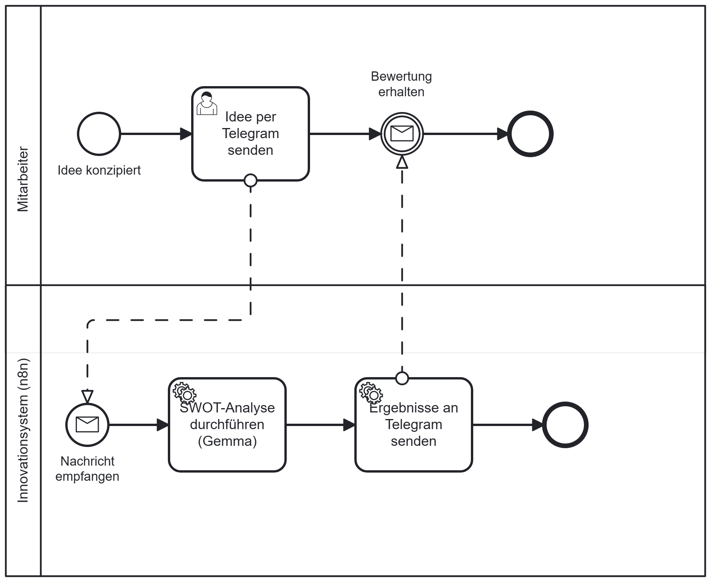

# 🚀 AI-gestützter SWOT-Analyse-Bot (n8n + Ollama + Telegram)

Automatisierter Workflow zur sofortigen Bewertung von Geschäftsideen: Mitarbeiter schicken ihre Idee per Telegram an einen Bot. Ein lokal betriebenes Large Language Model (LLM) analysiert sie und sendet eine strukturierte Bewertung mit Machbarkeit, Nutzen und SWOT-Matrix zurück. Die gesamte Verarbeitung läuft lokal, es entstehen keine Cloud-Kosten und keine Daten verlassen den eigenen Rechner.


---

## 📑 Inhaltsverzeichnis

1. [Systemarchitektur](#️-systemarchitektur)
2. [Prozessmodell (BPMN)](#-prozessmodell-bpmn)
3. [Verwendete Technologien](#️-verwendete-technologien)
4. [Funktionsweise](#️-funktionsweise)
5. [Voraussetzungen](#-voraussetzungen)
6. [Einrichtung](#-einrichtung)
7. [Beispiel](#-beispiel)
8. [Projektstruktur](#-projektstruktur)
9. [Einschränkungen](#️-einschränkungen)
10. [Ausblick](#-ausblick)
11. [Autor](#-autor)

---

## 🏗️ Systemarchitektur

```
Mitarbeiter ──► Telegram ──► n8n (Webhook) ──► Ollama / Gemma ──► n8n ──► Telegram ──► Mitarbeiter
                               ▲
                      ngrok-Tunnel (HTTPS)
```

| Komponente | Aufgabe |
|---|---|
| **Telegram-Bot** | Benutzeroberfläche für Eingabe und Ausgabe |
| **ngrok** | Stellt eine öffentliche HTTPS-URL für den Webhook bereit |
| **n8n (Docker)** | Orchestriert den Workflow |
| **Ollama + Gemma** | Lokale KI-Inferenz für die Analyse |

---

## 📐 Prozessmodell (BPMN)

Der Prozess wurde nach dem BPMN-2.0-Standard modelliert, mit zwei Pools (Mitarbeiter und Innovationssystem), je einem Nachrichtenfluss pro Richtung sowie passenden Aufgabentypen.



| Element | Typ | Beschreibung |
|---|---|---|
| Idee per Telegram senden | User Task | Der Mitarbeiter formuliert und sendet seine Idee |
| Nachricht empfangen | Message Start Event | Der Telegram-Trigger startet den Prozess im System |
| SWOT-Analyse durchführen (Gemma) | Service Task | Das lokale LLM erstellt die Bewertung |
| Ergebnisse an Telegram senden | Service Task | Das Ergebnis wird an den Nutzer zurückgeschickt |
| Bewertung erhalten | Message Intermediate Catch Event | Der Mitarbeiter erhält die Analyse |

Die Quelldatei ([`swot-bot-prozess.bpmn`](swot-bot-prozess.bpmn)) kann mit dem Camunda Modeler oder mit draw.io geöffnet und bearbeitet werden.

---

## 🛠️ Verwendete Technologien

- **n8n:** Workflow-Automatisierung, betrieben in Docker
- **Telegram Bot API:** Benutzeroberfläche für die Dateneingabe und die Ausgabe der Ergebnisse
- **Ollama (Gemma 4, 12B):** lokale KI-Inferenz, erreichbar über `host.docker.internal`
- **ngrok:** Tunnel mit statischer Domain, da Telegram-Webhooks eine öffentliche HTTPS-URL benötigen
- **BPMN 2.0 (Camunda Modeler):** formale Prozessmodellierung

---

## ⚙️ Funktionsweise

1. Der Nutzer sendet eine Idee als Text an den dedizierten Telegram-Bot.
2. Ein Webhook in n8n (Telegram Trigger) fängt die Nachricht ab.
3. Eine Basic LLM Chain gibt den Text zusammen mit einem Systemprompt an das lokale Gemma-Modell weiter.
4. Das Modell liefert eine Bewertung in festem Format: Zusammenfassung, Machbarkeit (X/10), Nutzen (X/10), SWOT-Matrix und Gesamtbewertung (X/10).
5. Ein Telegram-Node sendet das Ergebnis automatisch an den Chat des Nutzers zurück.

Der Systemprompt ist auf Englisch formuliert und gibt das Ausgabeformat verbindlich vor. Enthält die Nachricht keine Geschäftsidee, bittet das Modell den Nutzer, eine zu beschreiben.

---

## 📋 Voraussetzungen

- [Docker](https://www.docker.com/) (z. B. Docker Desktop)
- [Ollama](https://ollama.com/) mit dem Modell `gemma4:12b`
- Ein Telegram-Bot samt API-Token (erstellt über [@BotFather](https://t.me/BotFather))
- Ein [ngrok](https://ngrok.com/)-Konto mit kostenloser statischer Domain

---

## 🔧 Einrichtung

### 1. Ollama vorbereiten

```bash
ollama pull gemma4:12b
```

Prüfen, ob Ollama läuft: `http://localhost:11434` muss „Ollama is running" anzeigen.

### 2. ngrok-Tunnel starten

Telegram stellt Webhooks nur über HTTPS zu. Deshalb wird n8n über einen Tunnel öffentlich erreichbar gemacht. Das Terminal muss währenddessen geöffnet bleiben.

```bash
ngrok config add-authtoken <DEIN_NGROK_TOKEN>
ngrok http --url=<deine-domain>.ngrok-free.dev 5678
```

### 3. n8n in Docker starten

Die Tunnel-URL wird als `WEBHOOK_URL` übergeben (alles in einer Zeile):

```bash
docker run -it --name n8n -p 5678:5678 -e WEBHOOK_URL=https://<deine-domain>.ngrok-free.dev/ -v n8n_data:/home/node/.n8n docker.n8n.io/n8nio/n8n
```

Das Volume `n8n_data` sorgt dafür, dass Workflows und Credentials erhalten bleiben. Anschließend ist n8n unter `http://localhost:5678` erreichbar.

### 4. Workflow importieren

In n8n über das Menü **⋯ → Import from File** die Datei [`n8n-ai-idea-evaluator.json`](n8n-ai-idea-evaluator.json) auswählen.

### 5. Credentials anlegen

Die Datei enthält bewusst **keine Zugangsdaten**. Folgende Credentials müssen in n8n selbst angelegt werden:

| Credential | Einstellung |
|---|---|
| **Telegram API** | Access Token des Bots (von BotFather) |
| **Ollama** | Base URL: `http://host.docker.internal:11434` |

Danach in den Nodes *Telegram Trigger*, *Ollama Chat Model* und *Send a text message* jeweils die passende Credential auswählen.

### 6. Workflow veröffentlichen und testen

Oben rechts auf **Publish** klicken. Danach dem Bot auf Telegram eine Idee schicken, zum Beispiel:

> Ich möchte einen Bluetooth-Toaster entwickeln.

Nach einigen Sekunden trifft die Analyse im Chat ein.

### 🩺 Fehlerbehebung

| Problem | Ursache und Lösung |
|---|---|
| *„An HTTPS URL must be provided for webhook"* | `WEBHOOK_URL` fehlt oder ngrok läuft nicht. Tunnel starten und n8n mit `-e WEBHOOK_URL=…` neu starten. |
| *„Couldn't connect"* bei der Ollama-Credential | Base URL prüfen (keine Markdown-Klammern, keine Leerzeichen). Falls nötig, Ollama mit `OLLAMA_HOST=0.0.0.0:11434` neu starten. |
| *„No prompt specified"* | In der Basic LLM Chain *Source for Prompt* auf **Define below** stellen und `{{ $json.message.text }}` eintragen. |
| *„Bad Request: chat not found"* | Der Bot kennt den Chat nicht. Dieselbe Credential wie im Trigger verwenden und im Chat mit dem Bot `/start` senden. |
| Container-Name `n8n` ist bereits vergeben | Alten Container mit `docker rm n8n` entfernen. Die Daten bleiben im Volume erhalten. |

---

## 💬 Beispiel

**Eingabe (Telegram):**

> Ich möchte einen Bluetooth-Toaster entwickeln.

**Ausgabe des Bots:**

```
IDEA: A toaster equipped with Bluetooth connectivity for remote monitoring and adjustments.

FEASIBILITY: 4/10. Integrating a Bluetooth module is technically simple, but the cost of manufacturing may not be justified by the simple nature of the appliance.

BENEFIT: 3/10. The added convenience for the average user is very low. The product serves more as a novelty for tech enthusiasts.

SWOT
Strengths: Unique branding potential / Smart home system integration / Customizable notification alerts
Weaknesses: Higher production costs / Over-engineered solution / Narrow target audience
Opportunities: Partnerships with smart home apps / Custom toast presets / Marketing to early adopters
Threats: Market saturation by cheap models / Low demand from mainstream consumers / Complexity of software maintenance

OVERALL SCORE: 4/10. A niche gadget with limited mass-market appeal.
```

*(Die Ausgabe ist gekürzt dargestellt. Der tatsächliche Wortlaut variiert je nach Modelllauf.)*

---

## 📁 Projektstruktur

```
n8n-ai-idea-evaluator/
├── README.md                     # Projektdokumentation
├── n8n-ai-idea-evaluator.json    # Exportierter n8n-Workflow
├── swot-bot-prozess.bpmn         # BPMN-Quelldatei
└── swot-bot-prozess.png          # BPMN-Diagramm
```

---

## ⚠️ Einschränkungen

- **Tunnel nur für die Entwicklung:** Für die lokale Entwicklung wird ein HTTPS-Tunnel benötigt. In einer Produktivumgebung genügt ein Server mit eigener HTTPS-Domain.
- **Verfügbarkeit:** Der Bot funktioniert nur, solange Docker, ngrok und Ollama auf dem Rechner laufen.
- **Modellqualität:** Die Bewertung ist eine erste Einschätzung und ersetzt keine fundierte Marktanalyse. Sie hängt vom lokalen Modell ab und kann zwischen Läufen schwanken.
- **Sprache:** Der Systemprompt erzwingt englische Antworten, auch wenn die Idee auf Deutsch oder Italienisch eingereicht wird.
- **Nachrichtenlänge:** Telegram erlaubt rund 4096 Zeichen pro Nachricht. Der Prompt fordert daher eine kurze Antwort.

---

## 🔭 Ausblick

- Ergebnisse zusätzlich in einem Google Sheet oder in Notion archivieren
- Mehrsprachige Ausgabe abhängig von der Sprache des Nutzers
- Strukturierte Ausgabe (JSON) und Visualisierung der SWOT-Matrix
- Betrieb auf einem Server mit fester HTTPS-Domain statt ngrok
- Zugriffsbeschränkung auf freigegebene Telegram-Nutzer

---

## 👤 Autor

**Emanuele Ragusi**, Masterstudent Management Engineering am Politecnico di Torino

Dieses Projekt verbindet Prozessmodellierung (BPMN) mit Workflow-Automatisierung und lokaler KI.
